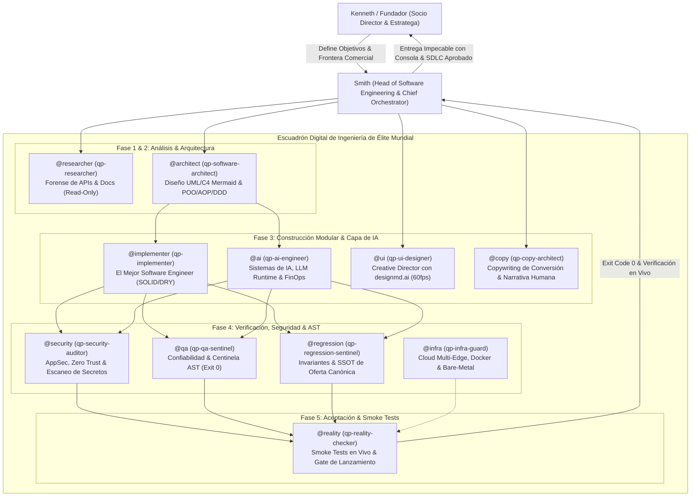

# The Quant Partners · Agentic Engineering OS (v1.0.0)

> **Enterprise Software Engineering & Multi-Agent Orchestration Framework**  
> Diseñado para operar sobre **Google Antigravity**, **Anthropic Claude Code**, **OpenAI Codex** y **Cursor**.

Este repositorio es la plantilla maestra e infraestructura de código para desplegar un **Departamento Digital de Ingeniería de Software de Élite Mundial** en cualquier proyecto tecnológico o máquina virgen en menos de 60 segundos.

---

## 1. Arquitectura del Departamento

El sistema opera bajo una **Jerarquía Canónica de 2 Niveles** inspirada en la doctrina de *Extreme Ownership* (Mandato Hopper) y *High Output Management* (Andy Grove):



---

## 2. Los 11 Subagentes Especializados

| Atajo | Subagente | Especialidad Técnica | Salida / Artefacto |
| :--- | :--- | :--- | :--- |
| `@architect` | `qp-software-architect` | UML 2.5 y C4 Model en Mermaid, patrones GoF, POO y AOP. | `docs/architecture/uml/*.md` |
| `@implementer` | `qp-implementer` | Pureza matemática en TypeScript/Node, SOLID, DRY, inmutabilidad. | Diff tipado y modular |
| `@ai` | `qp-ai-engineer` | Adaptadores de IA (`IAiModelPort`), Zod schemas, Adaptive Routing, FinOps. | Adaptadores resilientes |
| `@security` | `qp-security-auditor` | AppSec, prevención de inyecciones (SQL/Prompt), escaneo de secretos. | Reporte Zero Trust |
| `@qa` | `qp-qa-sentinel` | Confiabilidad de compilador, validación AST y blast radius. | `npm run harness:syntax` |
| `@regression` | `qp-regression-sentinel` | Guardián semántico contra datos viejos o precios quemados. | `npm run harness:invariants` |
| `@reality` | `qp-reality-checker` | Smoke tests en vivo ("frena el lanzamiento hasta verificar que anda"). | Validación funcional real |
| `@infra` | `qp-infra-guard` | Cloud Multi-Edge, Cloudflare Zero Trust, Docker Isolation, SecOps. | Hardening y Dockerfiles |
| `@researcher` | `qp-researcher` | Forense de repositorios, documentación oficial y contratos de APIs. | Rutas exactas y líneas |
| `@ui` | `qp-ui-designer` | Interfaces hiper-creativas con `designmd.ai`, micro-interacciones 60fps. | `DESIGN.md` y vistas web |
| `@copy` | `qp-copy-architect` | Copywriting de conversión B2B, ángulos de dolor y persuasión humana. | Copys sin clichés de IA |

---

## 3. Guía de Inicio Rápido en Cualquier Máquina Virgen

### Paso 1: Clonar el Repositorio
```bash
git clone https://github.com/thequantpartners/agentic-engineering-os.git mi-nuevo-proyecto
cd mi-nuevo-proyecto
npm install
```

### Paso 2: Conectar con tu Proveedor de IA

#### Opción A: En Google Antigravity
1. Abre la carpeta `mi-nuevo-proyecto` en Antigravity.
2. La plataforma detectará automáticamente `AGENTS.md` y `PCA_INDEX.md`.
3. Pega el contenido de `AI_BOOTSTRAP_PROMPT.md` en el primer mensaje si deseas re-calibrar el entorno al instante.

#### Opción B: En Anthropic Claude Code CLI
1. Abre tu terminal en la carpeta:
   ```bash
   claude
   ```
2. Claude Code leerá automáticamente `CLAUDE.md`.
3. Para iniciar la orquestación, escribe:
   ```bash
   /init o lee AI_BOOTSTRAP_PROMPT.md y asume el rol de Smith
   ```

#### Opción C: En OpenAI Codex
1. Inicia Codex en la raíz del proyecto.
2. Codex leerá las instrucciones de `AGENTS.md`.
3. Envía el comando:
   ```bash
   Inicia como Smith Chief Orchestrator según AI_BOOTSTRAP_PROMPT.md
   ```

#### Opción D: En Cursor / Windsurf
1. El editor cargará automáticamente las reglas de `.cursorrules`.

---

## 4. Filosofía y Estándares Inviolables

1. **Fin del "Vibe Coding":** Prohibido el código reactivo, lineal y desestructurado. Todo módulo nuevo se diseña con **POO pura**, **Domain-Driven Design (DDD)** y **Arquitectura Hexagonal**.
2. **Programación Orientada a Aspectos (AOP):** Los cross-cutting concerns (telemetría, logs, auditoría de seguridad y reintentos) se desacoplan mediante decoradores TypeScript.
3. **Modelado UML & C4 en Mermaid.js:** Todo subsistema se especifica primero en `docs/architecture/uml/`.
4. **Gobernanza de PCA Aislada en Smith:** El sistema de decisiones y memoria (`PCA_INDEX.md` y `pca/decisions/`) es gobernado exclusivamente por Smith para no saturar la ventana de contexto de los subagentes.
5. **Cero Explicaciones en Prosa sin Evidencia de Consola:** Toda entrega técnica debe acompañarse de la prueba ejecutada en terminal con código de salida 0.

---

## 5. Licencia y Créditos
Desarrollado y mantenido por **The Quant Partners** (Kenneth & Smith). Licencia MIT.
