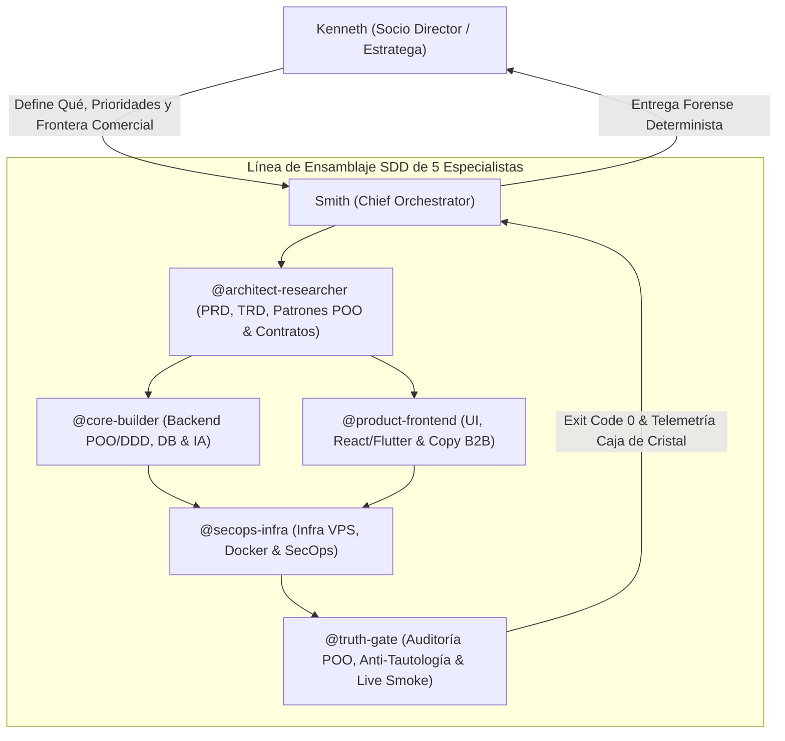

# The Quant Partners · Agentic Engineering OS (v2.0)

> **Enterprise Software Engineering & Multi-Agent Orchestration Framework**  
> Diseñado para operar sobre **Google Antigravity**, **Anthropic Claude Code**, **OpenAI Codex** y **Cursor**.

Este repositorio es la plantilla maestra e infraestructura de código para desplegar un **Departamento Digital de Ingeniería de Software de Grado Fellow** en cualquier proyecto tecnológico o máquina virgen en menos de 60 segundos.

---

## 🚀 Cómo usar este sistema en un Repositorio Virgen

Cuando crees un proyecto nuevo o un repositorio vacío, solo dile a tu agente de IA:

> *"Copia este repo de GitHub: `https://github.com/thequantpartners/agentic-engineering-os`, porque trabajaremos de esta manera."*

El agente clonará o adoptará la constitución (`AGENTS.md`), la plantilla SDD-6 (`docs/specs/_TEMPLATE_SDD_6.md`) y los arneses de terminal (`scripts/harness/`), activando inmediatamente el protocolo **`L0-bootstrap`** para inicializar el stack sin fricción.

---

## 1. Asimetría de Roles (Garantía Zero Human Code Review)

El sistema opera bajo una **asimetría de responsabilidades estricta**:



1. **Kenneth (Director):** Define el problema de negocio, objetivos y aprueba la arquitectura macro sin necesidad de auditar código línea por línea.
2. **Smith (Chief Orchestrator):** Compilador determinista del SDLC. Garantiza calidad de grado industrial mediante especificaciones previas (SDD), POO estricta, patrones de diseño bien aplicados y compuertas deterministas en terminal.

---

## 2. Los 5 Especialistas de Élite

| Subagente | Responsabilidad Principal | Invariante de Calidad |
| :--- | :--- | :--- |
| **`@architect-researcher`** | Redacción de PRD/TRD, contratos inmutables (`*.contract.*`), diagramas Mermaid y selección de patrones POO. | Cero código ejecutable sin contrato Zod/tipado y justificación de patrones. |
| **`@core-builder`** | Lógica de Dominio (POO/SOLID), Casos de Uso, Persistencia, colas, adaptadores de IA y APIs. | Encapsulamiento POO (`public`, `private`, `protected`, `readonly`), DI por constructor, Value Objects inmutables. |
| **`@product-frontend`** | Interfaces web/móviles desacopladas (Vista vs. Estado), responsividad (375px a 4K) y copy B2B. | Cero lógica de negocio en la vista, 4 estados UI cubiertos (Loading, Empty, Error, Success). |
| **`@secops-infra`** | Dockerfiles no-root, VPS/Coolify, Cloudflare, redes internas aisladas y gestión de secretos. | Cero puertos internos en `0.0.0.0`, cero contenedores root, cero secretos en código. |
| **`@truth-gate`** | Ejecución de arneses (`syntax`, `sdd`, `invariants`, `test`), auditoría POO y smoke tests. | Prohibido aprobar sin `exit code 0` real. Prohibido aceptar tests tautológicos con mocks falsos. |

### 2.1 ¿Cómo se crean los Subagentes en un Repo Virgen?
Las especificaciones formales de cada especialista residen en `.agents/subagents/*.md` con sus herramientas, permisos y restricciones inviolables.
* **En Plataformas Multi-Agente (ej. Google Antigravity):** En el primer turno (`L0-bootstrap`), Smith lee `.agents/subagents/` y registra a los especialistas dinámicamente con `define_subagent`.
* **En Asistentes Mono-Agente o CLI (ej. Claude Code, Cursor, OpenAI Codex):** Smith opera en **Modo Slicing de Contexto por Rol**: adopta secuencialmente la mentalidad de cada especialista delimitando el contexto a la sección del SDD que le corresponde y emitiendo el bloque visible `[SUBAGENTE: @nombre]`.

---

## 3. Tiers de Rigor & Proporcionalidad (Anti-Sobreingeniería)

Para evitar la burocracia innecesaria en tareas simples, el sistema modula el rigor según el alcance:

* **`L0-bootstrap` (Repo Virgen / Scaffolding Day-1):** Inicialización del proyecto (stack base, tipado estricto, estructura `apps/`, `packages/`, `docs/specs/` y arneses mínimos).
* **`L1-patch` (Cambios <50 líneas, 1-2 archivos):** Ejecución ágil por Smith. Resuelve de forma directa, ejecuta los arneses en consola y entrega sin burocracia documental.
* **`L2-feature` (Nuevas funcionalidades o integraciones):** Ciclo completo de 4 pasos (SDD con PRD + TRD y matriz POO) + Hard Stop Zero-Code en Paso 2.
* **`L3-system` (Nueva app o cambio de arquitectura core):** Ciclo completo + FMEA de resiliencia + registro de decisión arquitectónica (ADR).

---

## 4. Matriz Anti-Patternitis (Cuándo SÍ y Cuándo NO Usar Patrones)

| Problema Técnico real | Patrón Obligatorio | Cuándo NO usarlo (Evitar Sobreingeniería) |
| :--- | :--- | :--- |
| Recursos compartidos pesados (Pool DB, Redis, Telemetría) | **Singleton** controlado (`getInstance` + `close`) | Nunca en servicios de negocio o clases con estado por request. |
| >2 variantes de un algoritmo, proveedor IA o pasarela | **Strategy + Factory Method** | Si solo hay 1 implementación y no se planea otra en el PRD. |
| Integración con SDKs o APIs externas (WhatsApp, pagos, LLMs) | **Adapter + Circuit Breaker / Retry** | Nunca exponer tipos de librerías de terceros dentro del Dominio. |
| Flujos con etapas estrictas (bots conversacionales, órdenes) | **State Pattern / Finite State Machine (FSM)** | En CRUDs simples sin reglas de transición de estados. |
| Creación de objetos complejos con múltiples validaciones | **Builder / Static Factory Method** | En objetos simples de 2-3 propiedades (usar constructor directo). |
| Datos con reglas propias (Dinero, Teléfono, Email) | **Value Object Inmutable** (autovalidado) | En IDs o textos simples sin invariantes de formato. |
| Guardar en BD y emitir evento sin perder datos | **Transactional Outbox + Idempotency Lease** | En lecturas simples o tareas sin efectos secundarios críticos. |

---

## 5. Arneses Deterministas de Terminal

El sistema garantiza calidad sin revisión humana manual ejecutando arneses con código de salida estricto (`exit code 0`):

```bash
# Validador de sintaxis y árboles AST (Full-Stack)
npm run harness:syntax

# Validador del estándar Spec-Driven Development (SDD-6)
npm run harness:sdd

# Compuerta bloqueante para CI/CD (exige specs aprobadas)
npm run harness:sdd:gate

# Verificación de tipos nativa
npm run typecheck

# Suite completa de verificación
npm test
```

---

## 6. Estructura del Repositorio

```text
├── .agents/
│   └── subagents/             # Especificaciones formales de los 5 especialistas
├── AGENTS.md                  # Constitución Kernel de Ingeniería & Orquestación
├── AI_BOOTSTRAP_PROMPT.md     # Prompt maestro de inicialización para cualquier IA
├── CLAUDE.md                  # Configuración nativa para Anthropic Claude Code
├── .cursorrules               # Reglas canónicas para Cursor y Windsurf
├── docs/
│   ├── engineering/           # Doctrinas canónicas de ingeniería
│   └── specs/                 # Especificaciones SDD activas
│       └── _TEMPLATE_SDD_6.md # Plantilla maestra SDD-6 con matriz POO
├── scripts/
│   └── harness/               # Arneses deterministas ejecutables (syntax, sdd, etc.)
└── package.json               # Scripts canónicos y herramientas de verificación
```

---

## 7. Licencia
Desarrollado y mantenido por **The Quant Partners** (Kenneth & Smith). Licencia MIT.
