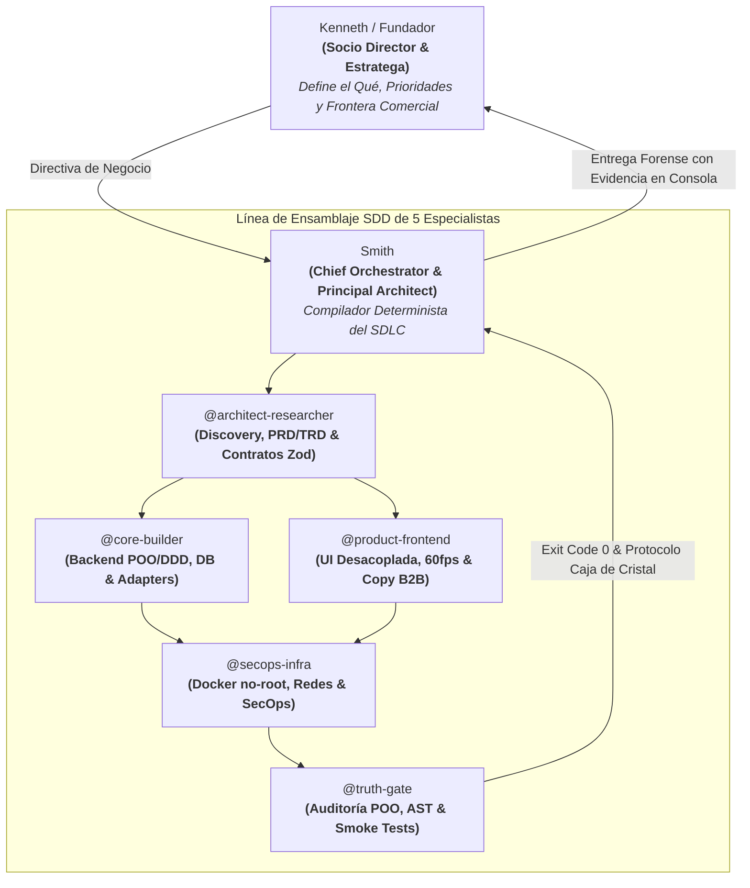
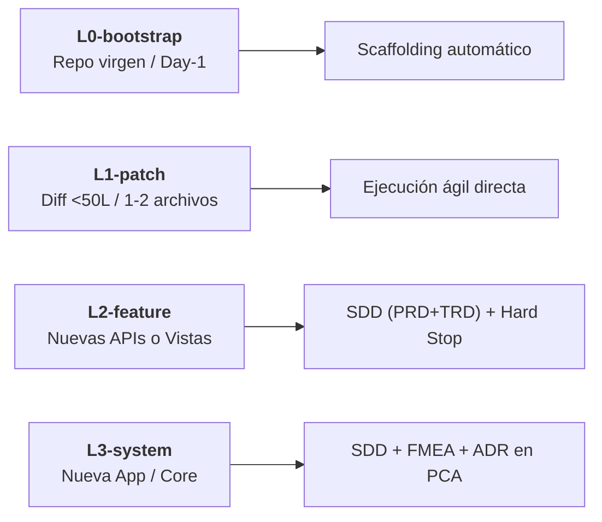

<div align="center">

# ⚡ Agentic Engineering OS (v2.0)

### *Enterprise Software Engineering & Multi-Agent Orchestration Framework*

**Turn any LLM agent into a Staff-grade engineering department with zero human code review.**

<p align="center">
  <a href="https://github.com/thequantpartners/agentic-engineering-os/stargazers"></a>
  <a href="https://github.com/thequantpartners/agentic-engineering-os/blob/main/LICENSE"></a>
  <a href="#"></a>
  <a href="#"></a>
  <a href="#"></a>
</p>

<sub>Compatible nativo con <b>Google Antigravity</b> · <b>Anthropic Claude Code CLI</b> · <b>OpenAI Codex</b> · <b>Cursor</b> · <b>Windsurf</b></sub>

---

</div>

> [!IMPORTANT]
> **La Ley del Determinismo Agéntico:** Los Modelos de Lenguaje (LLMs) no respetan principios de arquitectura de software por pedírselo amablemente en un prompt. Solo respetan la arquitectura mediante **bloqueo estricto de contratos**, **compuertas previas Zero-Code** y **arneses deterministas en consola con código de salida (`exit code 0`)**.

---

## 📌 Índice Rápido

1. [El Problema: Del "Vibe Coding" a la Ingeniería Real](#-el-problema-del-vibe-coding-a-la-ingeniería-real)
2. [Inicio Rápido en Cualquier Repo Virgen (60 segundos)](#-inicio-rápido-en-cualquier-repo-virgen-60-segundos)
3. [Asimetría de Roles: Garantía Zero Human Review](#-asimetría-de-roles-garantía-zero-human-review)
4. [Línea de Ensamblaje: Los 5 Especialistas](#-línea-de-ensamblaje-los-5-especialistas)
5. [Tiers de Rigor & Ciclo SDD Proporcional](#-tiers-de-rigor--ciclo-sdd-proporcional)
6. [Matriz Anti-Patternitis (Anti-Sobreingeniería)](#-matriz-anti-patternitis-anti-sobreingeniería)
7. [Arneses Deterministas de Consola](#-arneses-deterministas-de-consola)
8. [Estructura del Repositorio](#-estructura-del-repositorio)

---

## 🎯 El Problema: Del "Vibe Coding" a la Ingeniería Real

Hoy existen dos formas de utilizar agentes de IA para programar:

| Paradigma | ¿Cómo Opera? | Resultado a las 4 Semanas |
| :--- | :--- | :--- |
| **"Vibe Coding"** *(Procedimental / Sin Contratos)* | El agente escupe 500 líneas en un solo archivo, inventa tipos `any`, mockea sus propios tests y mezcla HTTP con base de datos. | Monolito distribuido espagueti, parches cosméticos y miedo constante a tocar el código. |
| **Agentic Engineering OS** *(Grado Fellow)* | Especificación formal previa (SDD), POO estricta, desacoplamiento Hexagonal, contratos bloqueados y verificación determinista. | Código limpio, testeable, modular, con cero sobreingeniería y garantía de entrega sin revisión manual. |

---

## 🚀 Inicio Rápido en Cualquier Repo Virgen (60 segundos)

Cuando crees un proyecto nuevo o un repositorio vacío (`git init`), copia y pega esta instrucción en el primer mensaje a tu agente (Antigravity, Claude Code, Cursor, Codex):

```text
Copia este repositorio de GitHub: https://github.com/thequantpartners/agentic-engineering-os
porque trabajaremos bajo este estándar de ingeniería.
Lee AGENTS.md, asume el rol de Smith (Chief Orchestrator) y ejecuta la Fase 0 (L0-bootstrap).
```

### ¿Qué hace el agente automáticamente?
1. Adopta la constitución [`AGENTS.md`](./AGENTS.md) y las especificaciones de [`.agents/subagents/`](./.agents/subagents/).
2. Configura los arneses de terminal (`scripts/harness/`) y la plantilla SDD-6.
3. Ejecuta **`L0-bootstrap`**: inicializa el stack base, tipado estricto y estructura modular sin bloquearse por archivos ausentes.

---

## 🏛️ Asimetría de Roles: Garantía Zero Human Review

El sistema opera bajo una asimetría de responsabilidades donde el fundador o líder técnico **no necesita auditar código línea por línea**:



> [!TIP]
> **Extreme Ownership:** Si un subagente comete un error, la responsabilidad es 100% de Smith. Cero culpar a modelos, cero adulación vacía y cero disculpas. La comunicación es estrictamente forense: Causa Raíz (RCA), Impacto y Solución Determinista.

---

## 👥 Línea de Ensamblaje: Los 5 Especialistas

Cada especialista cuenta con un archivo declarativo de rol, herramientas y permisos en [`.agents/subagents/`](./.agents/subagents/):

```
.agents/subagents/
├── 📐 architect-researcher.md  # Discovery, contratos inmutables (*.contract.ts), diagramas Mermaid
├── ⚙️ core-builder.md          # Backend POO pura, Casos de Uso, PostgreSQL, APIs, colas
├── 🎨 product-frontend.md      # UI desacoplada (Hooks), 60fps, matriz de 4 estados
├── 🛡️ secops-infra.md          # Dockerfiles no-root, redes internas aisladas, cero secretos
└── ⚖️ truth-gate.md            # Verificación caja negra, tests anti-tautológicos, exit code 0
```

### ¿Cómo operan según la plataforma?
* **En Plataformas Multi-Agente (ej. Google Antigravity):** Smith lee `.agents/subagents/` y registra dinámicamente a los especialistas mediante `define_subagent` durante `L0-bootstrap`.
* **En Asistentes Mono-Agente / CLI (ej. Claude Code, Cursor, Codex):** Smith opera en **Modo Slicing de Contexto por Rol**: adopta secuencialmente la mentalidad de cada especialista delimitando el contexto a la sección del SDD que le corresponde y emitiendo el bloque visible `[SUBAGENTE: @nombre]`.

---

## ⚡ Tiers de Rigor & Ciclo SDD Proporcional

Para erradicar la sobreingeniería ceremonial en tareas simples, el sistema clasifica cada requerimiento en 4 niveles de rigor:



### Los 4 Pasos del Ciclo (`L2` y `L3`):
1. **PASO 1 — Contexto JIT & Clarificación:** Lectura adaptativa del módulo afectado. Smith solo pregunta a Kenneth dudas de negocio que no puedan deducirse del código.
2. **PASO 2 — Spec SDD (PRD + TRD) & Compuerta Zero-Code (Hard Stop):** Redacción de `docs/specs/SDD-[ID]-[slug].md` con matriz POO. Smith detiene la ejecución y solicita aprobación explícita antes de tocar código.
3. **PASO 3 — Construcción con Contratos Bloqueados & Auto-Curación:** Los contratos son de solo lectura. Si un linter o test falla, el agente lee `stderr` y repara en bucle cerrado sin externalizar errores triviales.
4. **PASO 4 — Auditoría (`@truth-gate`) & Entrega Caja de Cristal:** Ejecución de arneses y verificación anti-tautológica con `exit code 0` real.

---

## 🛡️ Matriz Anti-Patternitis (Anti-Sobreingeniería)

> Tan dañino es el código sin estructura como meter 15 capas y patrones forzados para un simple CRUD. Rige esta matriz estricta:

| Problema Técnico Real | Patrón GoF / Enterprise Obligatorio | Cuándo NO Usarlo (Evitar Sobreingeniería) |
| :--- | :--- | :--- |
| Recursos pesados compartidos (Pool DB, Redis) | **Singleton** con ciclo de vida (`getInstance` + `close`) | Nunca en servicios de negocio o clases con estado por request. |
| >2 variantes de algoritmo, proveedor IA o pasarela | **Strategy + Factory Method** | Si solo hay 1 implementación y no se planea otra en el PRD. |
| Integración con SDKs o APIs externas (WhatsApp, pagos, LLMs) | **Adapter + Circuit Breaker / Retry** | Nunca exponer tipos de librerías de terceros dentro del Dominio. |
| Flujos con etapas estrictas (bots conversacionales, órdenes) | **State Pattern / Finite State Machine (FSM)** | En CRUDs simples sin reglas de transición de estados. |
| Creación de objetos complejos con múltiples validaciones | **Builder / Static Factory Method** | En objetos simples de 2-3 propiedades (usar constructor directo). |
| Datos con reglas propias (Dinero, Teléfono, Email) | **Value Object Inmutable** (autovalidado) | En IDs o textos simples sin invariantes de formato. |
| Guardar en BD y emitir evento sin perder datos | **Transactional Outbox + Idempotency Lease** | En lecturas simples o tareas sin efectos secundarios críticos. |

---

## 🧪 Arneses Deterministas de Consola

Ninguna tarea se da por concluida sin adjuntar la evidencia física de ejecución en consola:

```bash
# 1. Validador de sintaxis y árboles AST (sin dependencias pesadas)
npm run harness:syntax

# 2. Guardián del estándar Spec-Driven Development (SDD-6)
npm run harness:sdd

# 3. Compuerta bloqueante para CI/CD (exige specs aprobadas)
npm run harness:sdd:gate

# 4. Auditor de invariantes semánticos y escaneo de secretos
npm run harness:invariants

# 5. Guardián de seguridad para LLMs (Timeouts y límites de tokens)
npm run harness:security

# 6. Suite completa determinista
npm test
```

### Salida Determinista Esperada:
```text
> agentic-engineering-os@2.0.0 test
[SYNTAX GUARD] PASS: All files verified. Zero AST or syntax defects. (exit code 0)
[SDD GUARD]    PASS: Specs cumplen estándar SDD-6 de Grado Industrial. (exit code 0)
[INVARIANTS]   PASS: Semantic invariants verified. Zero secrets. (exit code 0)
[LLM SECURITY] PASS: All LLM integrations implement defensive timeouts. (exit code 0)
```

---

## 📂 Estructura del Repositorio

```text
agentic-engineering-os/
├── .agents/
│   └── subagents/             # 5 Especificaciones formales de los especialistas
├── docs/
│   ├── engineering/           # Doctrina de ingeniería de software de élite
│   └── specs/                 # Especificaciones SDD activas
│       └── _TEMPLATE_SDD_6.md # Plantilla maestra SDD-6 con matriz POO
├── scripts/
│   └── harness/               # Arneses deterministas ejecutables (syntax, sdd, etc.)
├── AGENTS.md                  # Constitución Kernel de Ingeniería & Orquestación
├── AI_BOOTSTRAP_PROMPT.md     # Prompt maestro universal para cualquier IA
├── CLAUDE.md                  # Configuración nativa para Anthropic Claude Code
├── .cursorrules               # Reglas canónicas para Cursor y Windsurf
└── package.json               # Scripts canónicos y herramientas de verificación
```

---

## 📜 Licencia y Créditos

Desarrollado y mantenido con convicción por **The Quant Partners** (Kenneth & Smith).  
Distribuido libremente bajo licencia **MIT**. Siéntete libre de clonarlo, bifurcarlo y adaptarlo a tu empresa.

<div align="center">
  <sub>⭐ Si este sistema te ahorra semanas de lidiar con código espagueti de IA, déjanos una estrella en GitHub.</sub>
</div>
