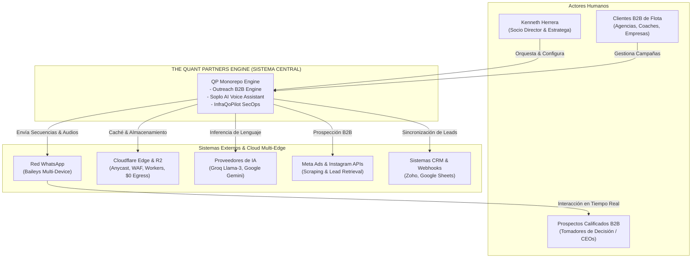
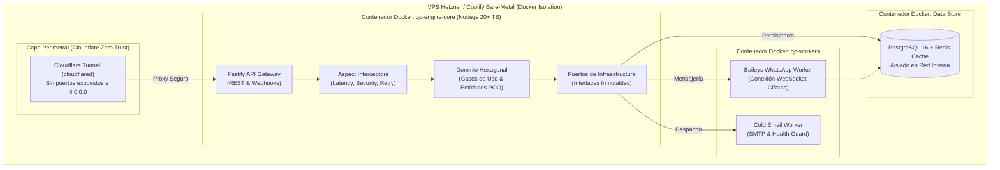
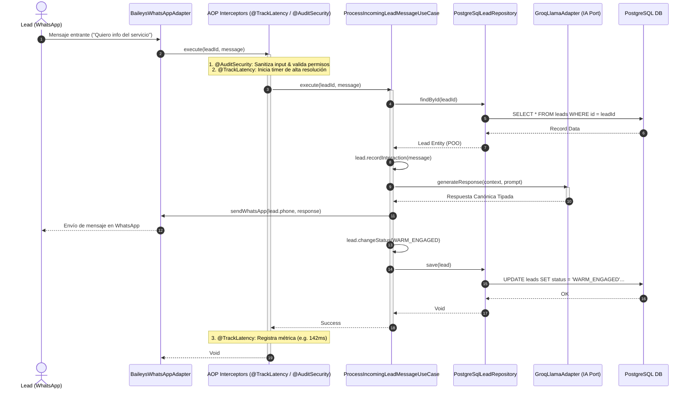
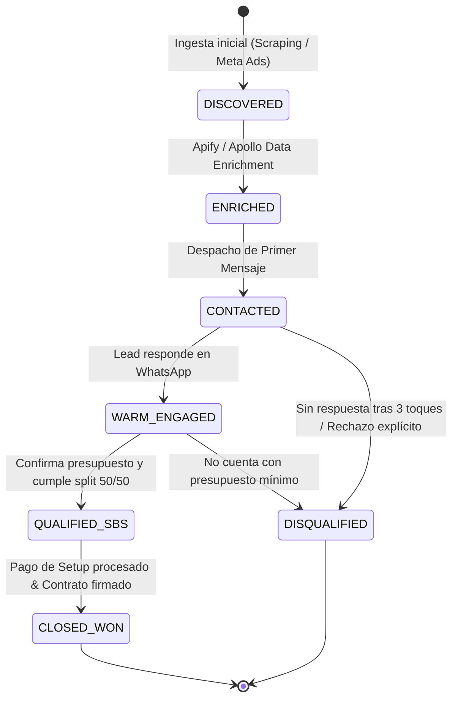

# Arquitectura Canónica del Sistema: Modelo C4 & UML 2.5 en Mermaid

> **Declaración Canónica:** LEI AGENTS Y PCA  
> **Formato:** Mermaid.js Nativo en Markdown (AI Context Parseable + Visual Rendering)  
> **Ubicación Canónica:** `docs/architecture/uml/canonical-system-architecture.md`

---

## 1. C4 Model — Nivel 1: Contexto del Sistema (System Context)

Muestra los límites del sistema The Quant Partners Engine, los actores humanos y los sistemas externos que interactúan con él.

---

## 2. C4 Model — Nivel 2: Contenedores (Container Diagram)

Detalla los contenedores de software que componen el monorepo y cómo se comunican bajo la doctrina Zero Trust.

---

## 3. Diagrama de Clases POO / DDD (Class Diagram)

Modela la pureza orientada a objetos del núcleo de negocio: Entidades con identidad, Value Objects inmutables, Casos de Uso y Puertos desacoplados.

```mermaid
classDiagram
    direction TB

    %% Value Objects Inmutables
    class LeadId {
        -string value
        +create(raw: string) LeadId
        +toString() string
    }

    class PhoneNumber {
        -string value
        +create(raw: string) PhoneNumber
        +toString() string
    }

    class LeadBudget {
        -number amount
        -string currency
        +create(amount: number, currency: string) LeadBudget
        +isSbsCompliant() boolean
    }

    class LeadStatus {
        <<enumeration>>
        DISCOVERED
        ENRICHED
        CONTACTED
        WARM_ENGAGED
        QUALIFIED_SBS
        CLOSED_WON
        DISQUALIFIED
    }

    %% Entidad Raíz de Agregado
    class Lead {
        -LeadId id
        -PhoneNumber phone
        -LeadBudget budget
        -LeadStatus status
        -Date createdAt
        -Date updatedAt
        +changeStatus(newStatus: LeadStatus) void
        +recordInteraction(message: string) void
        +isQualifiedForClosing() boolean
    }

    %% Puertos Hexagonales (Interfaces)
    class ILeadRepository {
        <<interface>>
        +findById(id: LeadId) Promise~Lead~
        +save(lead: Lead) Promise~void~
    }

    class IAiModelPort {
        <<interface>>
        +generateResponse(context: string, prompt: string) Promise~string~
    }

    class IMessageDispatcherPort {
        <<interface>>
        +sendWhatsApp(to: PhoneNumber, body: string) Promise~boolean~
    }

    %% Adaptadores de Infraestructura
    class PostgreSqlLeadRepository {
        -DatabaseClient db
        +findById(id: LeadId) Promise~Lead~
        +save(lead: Lead) Promise~void~
    }

    class GroqLlamaAdapter {
        -string apiKey
        -string model
        +generateResponse(context: string, prompt: string) Promise~string~
    }

    class BaileysWhatsAppAdapter {
        -WASocket socket
        +sendWhatsApp(to: PhoneNumber, body: string) Promise~boolean~
    }

    %% Caso de Uso Orquestador
    class ProcessIncomingLeadMessageUseCase {
        -ILeadRepository leadRepo
        -IAiModelPort aiPort
        -IMessageDispatcherPort dispatcher
        +execute(leadId: string, message: string) Promise~void~
    }

    %% Relaciones POO
    Lead *-- LeadId : compone
    Lead *-- PhoneNumber : compone
    Lead *-- LeadBudget : compone
    Lead *-- LeadStatus : tiene estado

    ProcessIncomingLeadMessageUseCase --> ILeadRepository : depende de
    ProcessIncomingLeadMessageUseCase --> IAiModelPort : depende de
    ProcessIncomingLeadMessageUseCase --> IMessageDispatcherPort : depende de

    PostgreSqlLeadRepository ..|> ILeadRepository : implementa
    GroqLlamaAdapter ..|> IAiModelPort : implementa
    BaileysWhatsAppAdapter ..|> IMessageDispatcherPort : implementa
```

---

## 4. Diagrama de Secuencia con AOP (Sequence Diagram)

Ilustra la ejecución determinista del Caso de Uso, mostrando cómo los **Aspectos transversales (AOP)** interceptan la llamada sin contaminar el dominio.

---

## 5. Diagrama de Estados Finitos del SMF (State Diagram)

Modela el ciclo de vida determinista de un lead en el motor comercial:

