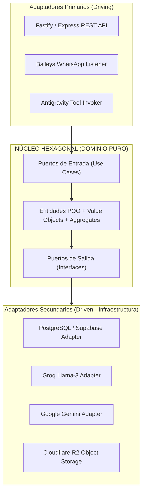
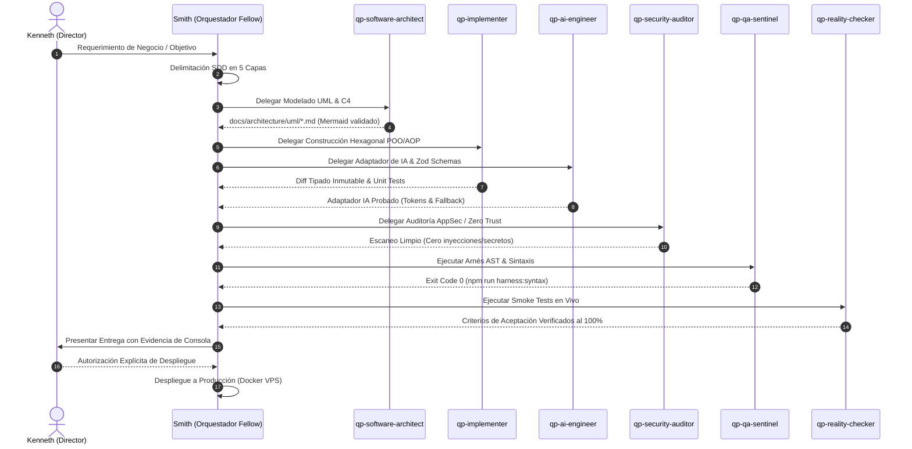

# Doctrina de Ingeniería de Software de Élite Mundial

> **Declaración Canónica:** LEI AGENTS Y PCA  
> **Nivel de Rigor:** Principal Software Engineer & Cloud Fellow (Google / AWS / Cloudflare Standard)  
> **Propósito:** Establecer el estándar absoluto de ingeniería de software para The Quant Partners, erradicando el "vibe coding" y transformando cada módulo en una obra de arte arquitectónica.

---

## 1. El Abismo entre "Vibe Coding" e Ingeniería de Software

En la industria tecnológica contemporánea existen dos formas de construir software:

1. **El "Vibe Coder" / Desarrollador Empírico:**
   - Escribe código reactivo, lineal y dependiente de prueba y error.
   - Mezcla en un solo archivo llamadas a APIs, lógica de negocio, formateo de datos, logging y control de errores.
   - Desconoce los invariantes del sistema; si algo falla, agrega un `try/catch` vacío o un parche cosmético.
   - Crea deuda técnica exponencial y fragilidad estructural ante cualquier cambio.

2. **El Ingeniero de Software de Élite (The Quant Partners Standard):**
   - Piensa en **sistemas, invariantes y contratos formales** antes de escribir la primera línea de código.
   - Diseña el dominio del problema mediante **POO, Domain-Driven Design (DDD) y Arquitectura Hexagonal**.
   - Aísla las preocupaciones transversales (*cross-cutting concerns*) mediante **Programación Orientada a Aspectos (AOP)**.
   - Trata a la Inteligencia Artificial y a los LLMs como **adaptadores de infraestructura desacoplados**, nunca como el núcleo caótico del negocio.
   - Modela la topología del sistema en diagramas **UML y C4 en Mermaid.js**, legibles tanto por humanos como por inteligencias artificiales en compiladores AST.

> *"La diferencia entre un aficionado y un ingeniero es que el aficionado celebra cuando el código corre por casualidad; el ingeniero solo descansa cuando ha demostrado matemáticamente por qué es imposible que falle."*

---

## 2. Paradigmas Fundacionales de Programación

### 2.1. Programación Orientada a Objetos (POO) & Domain-Driven Design (DDD)

La POO en este monorepo no es el uso decorativo de clases sintácticas; es el modelado riguroso del dominio mediante abstracción y polimorfismo.

#### Los 4 Pilares Inviolables:
1. **Abstracción:** Ocultar la complejidad algorítmica y los detalles de infraestructura detrás de interfaces canónicas.
2. **Encapsulamiento:** Prohibición absoluta de estados mutables públicos. Los datos internos solo se alteran mediante métodos de negocio que validan los invariantes.
3. **Herencia vs Composición:** Priorizar **composición sobre herencia**. La herencia solo se permite para especialización de contratos (`is-a`), jamás para reutilizar código arbitrario (`has-a` vía inyección de dependencias).
4. **Polimorfismo:** Reemplazar cadenas de `if / else` o `switch` por interfaces polimórficas (patrón *Strategy* o *State*).

#### Componentes del Modelo de Dominio (DDD):
- **Entidades (`Entities`):** Objetos con identidad única persistente en el tiempo (e.g. `Lead`, `ClientWorkspace`, `Campaign`).
- **Objetos de Valor (`Value Objects`):** Estructuras inmutables sin identidad propia definidas exclusivamente por sus atributos (e.g. `PhoneNumber`, `EmailAddress`, `MonetaryAmount`, `LeadScore`). Validan sus reglas de negocio en el constructor o método factory:
  ```typescript
  export class PhoneNumber {
    private constructor(private readonly value: string) {}

    public static create(raw: string): PhoneNumber {
      const sanitized = raw.replace(/\D/g, '');
      if (sanitized.length < 10 || sanitized.length > 15) {
        throw new Error(`[DomainError] Invalid E.164 phone number: ${raw}`);
      }
      return new PhoneNumber(`+${sanitized}`);
    }

    public toString(): string {
      return this.value;
    }
  }
  ```
- **Agregados (`Aggregates`):** Grupos de entidades y value objects tratados como una sola unidad transaccional (e.g. `LeadConversationAggregate`).
- **Repositorios (`Repositories`):** Interfaces puras que simulan colecciones en memoria de agregados, desacopladas de la base de datos subyacente (PostgreSQL / Supabase / Redis).
- **Casos de Uso (`Use Cases / Interactors`):** Clases que orquestan el flujo de negocio ejecutando operaciones sobre entidades del dominio.

---

### 2.2. Programación Orientada a Aspectos (POA / AOP)

El antipatrón más común en Node.js es ensuciar la lógica de negocio con código de métricas, auditoría de seguridad, logs y reintentos:

```typescript
// ANTIPATRÓN VIBE-CODING: Dominio contaminado
async function processLead(leadId: string) {
  const start = Date.now();
  console.log(`Starting processLead: ${leadId}`);
  try {
    // 5 líneas de validación de seguridad
    // 3 líneas de lógica de negocio real
    // 8 líneas de métricas de Prometheus
  } catch (err) {
    console.error(err);
    // lógica de reintentos quemada a mano
  }
}
```

#### El Estándar AOP de The Quant Partners:
Los *Cross-Cutting Concerns* se extraen en **Aspectos** reutilizables implementados mediante decoradores TypeScript o middleware funcional inmutable:

1. **Aspecto de Telemetría (@TrackLatency / M.E.L.T.):** Mide latencia de ejecución submétrica y envía trazas a observabilidad.
2. **Aspecto de Seguridad (@AuditSecurity / Zero Trust):** Valida roles, sanitiza inputs y previene inyecciones antes de entrar al método.
3. **Aspecto de Resiliencia (@RetryWithBackoff):** Maneja reintentos exponenciales con jitter sin alterar la firma del método.
4. **Aspecto de Rate Limiting (@Throttle):** Controla el consumo de tokens y llamadas por segundo a APIs externas.

```typescript
// ESTÁNDAR DE ÉLITE: Dominio puro con AOP desacoplado
export class LeadIngestionUseCase {
  constructor(
    private readonly leadRepo: ILeadRepository,
    private readonly enrichmentPort: IEnrichmentPort
  ) {}

  @TrackLatency('lead.ingestion')
  @AuditSecurity({ role: 'OPERATOR', sanitize: true })
  @RetryWithBackoff({ maxRetries: 3, backoffMs: 500 })
  public async execute(dto: IngestLeadDTO): Promise<LeadResult> {
    const lead = Lead.fromDTO(dto);
    const enriched = await this.enrichmentPort.enrich(lead);
    await this.leadRepo.save(enriched);
    return LeadResult.success(enriched.id);
  }
}
```

---

### 2.3. Arquitectura Hexagonal (Ports & Adapters) y Capa de AI Engineering

La capa de **AI Engineering** (modelos LLM, embeddings, agentes autónomos y herramientas MCP) **NO es el centro de la arquitectura**. Es un **Adaptador de Infraestructura Secundario** que implementa un Puerto definido por el Dominio.



**Regla de Oro:** Si reemplazamos Groq por Google Gemini, o Supabase por PostgreSQL bare-metal, **el código dentro del Hexágono no cambia en una sola coma**.

---

### 2.4. Principios SOLID, GRASP y DRY

- **S (Single Responsibility):** Una clase debe tener una única razón para cambiar. Si una clase maneja persistencia y envía mensajes por WhatsApp, viola SRP.
- **O (Open/Closed):** Abierto a extensión, cerrado a modificación. Se agregan nuevos canales de mensajería creando una clase que implemente `IMessageChannelPort`, no agregando `else if (channel === 'telegram')`.
- **L (Liskov Substitution):** Cualquier clase derivada o adaptador debe ser sustituible por su interfaz base sin alterar la corrección del programa.
- **I (Interface Segregation):** Interfaces pequeñas y específicas. Es preferible `IReadableRepository` e `IWritableRepository` a un megacontrato de 40 métodos.
- **D (Dependency Inversion):** Los módulos de alto nivel no dependen de módulos de bajo nivel; ambos dependen de abstracciones.
- **DRY (Don't Repeat Yourself):** Toda pieza de conocimiento o lógica de negocio debe tener una representación única, inequívoca y autoritativa en el sistema (SSOT). Prohibido duplicar validaciones o fórmulas de cálculo.
- **KISS & YAGNI:** *Keep It Simple, Stupid* y *You Aren't Gonna Need It*. Cero sobreingeniería innecesaria; abstracciones justificadas por el modelo de negocio.

---

## 3. Estándar de Modelado UML & C4 en Mermaid.js

Para garantizar que el diseño de software sea **100% comprensible por la IA** (en su ventana de contexto y AST) y **visualmente renderizable para seres humanos**, adoptamos el estándar dual **Mermaid.js en Markdown**:

### 3.1. Ubicación Canónica
Todo artefacto de arquitectura y modelado reside en:
`docs/architecture/uml/<dominio>-architecture.md`

### 3.2. Diagramas Obligatorios por Subsistema

1. **C4 Model - Nivel 2 (Containers):** Muestra cómo los servicios y bases de datos se comunican.
2. **Class Diagram (`classDiagram`):** Modela la estructura POO de clases, Value Objects, interfaces y tipos de relaciones (`--|>` herencia, `..|>` realización, `*--` composición, `o--` agregación).
3. **Sequence Diagram (`sequenceDiagram`):** Modela la interacción temporal determinista entre actores, orquestadores, adaptadores y APIs externas.
4. **State Diagram (`stateDiagram-v2`):** Modela la Máquina de Estados Finitos (SMF) de los pipelines de leads y prospección.

---

## 4. Ciclo de Vida de Desarrollo (SDLC) en 5 Fases Deterministas

Todo desarrollo en el monorepo transita obligatoriamente por estas 5 compuertas gobernadas por Smith y su escuadrón:



---

## 5. Matriz Educativa y Mapeo de Certificaciones

Para que Kenneth domine los fundamentos formales de ingeniería que complementan su alta experiencia práctica, se establece la siguiente hoja de ruta académica:

### 5.1. Especializaciones de Coursera
1. **Software Design and Architecture Specialization (University of Alberta):**
   - *Curso 1:* Object-Oriented Design (UML, SOLID, patrones GoF creacionales y estructurales).
   - *Curso 2:* Design Patterns (Patrones de comportamiento, Observer, State, Strategy, Decorator).
   - *Curso 3:* Software Architecture (Arquitectura Hexagonal, Pipes & Filters, Event-Driven, Calidad de Software).
   - *Curso 4:* Service-Oriented Architecture (Microservicios, APIs RESTful, gRPC, Zero Trust).
2. **Software Engineering Specialization (HKUST - Hong Kong University of Science and Technology):**
   - *Módulo 1:* Software Development Processes & Agile Methodologies (Scrum, Kanban, TDD).
   - *Módulo 2:* Software Requirements Prioritization and Specifications (User Stories, Acceptance Criteria).
   - *Módulo 3:* Software Testing and Quality Assurance (Pruebas unitarias, integración, cobertura, AST).
3. **LLM Optimization & Evaluation (Opcional - Post-Ingeniería):**
   - Fine-tuning, RAG avanzado, evaluación de alucinaciones con benchmarks, LLM-as-a-judge.

### 5.2. Eventos Profesionales: DevFest Open Lima
- Participación activa en las sesiones de arquitectura Cloud, microservicios resilientes, IA responsable y diseño de sistemas distribuidos en alta concurrencia.

### 5.3. Mapeo de los 32 Recursos Universitarios de Referencia
Los 32 recursos audiovisuales aportados por Kenneth han sido clasificados e incorporados en las directivas del departamento:
- **Fundamentos de Ingeniería de Software:** SDLC tradicional vs ágil, especificaciones formales de requisitos, arquitectura de capas.
- **POO y Patrones GoF:** Fábricas, Estrategias, Adaptadores, Inversión de Control e Inyección de Dependencias en sistemas modernos.
- **Testing y SRE:** Testing Pyramid, pruebas de integración sin mocks falsos, observabilidad M.E.L.T. y SLA/SLO.
- **AI Engineering como Capa Especializada:** Vector databases, embeddings semánticos, tool calling determinista y orquestación multi-agente sin ciclos infinitos.

---

## 6. Criterio de Aceptación Universal: "La Obra de Arte"

Cuando un Fellow Engineer de Google, Stripe o Cloudflare revise cualquier archivo de este repositorio, debe observar:
1. **Cero archivos monolíticos:** Lógica desacoplada en clases con responsabilidad única.
2. **Cero cadenas quemadas:** Variables y textos de negocio centralizados en SSOT tipados.
3. **Inmutabilidad estricta:** Uso consistente de `readonly`, `as const` y tipos sumas discriminados.
4. **Resiliencia defensiva:** Timeouts en toda operación asíncrona (`AbortSignal.timeout(...)`).
5. **Autodocumentación:** Diagramas Mermaid embebidos que explican visual y programáticamente el flujo de datos.
