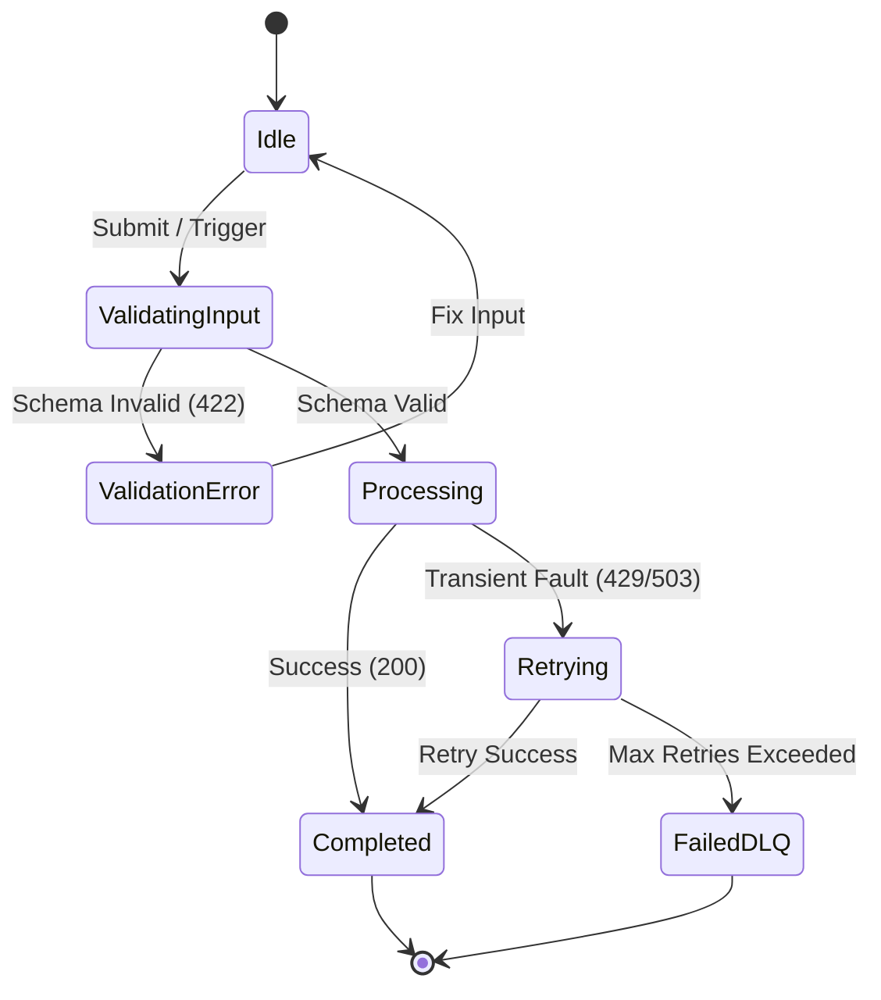

<!-- @slice:shared -->
## 1. PRD & Business Invariants (Product Requirements)

### 1.1 Problema y Objetivo Operativo
Descripción directa del problema técnico o de negocio y el resultado medible en 3 a 5 líneas. Especifica el valor esperado sin literatura innecesaria.

### 1.2 Criterios de Aceptación Deterministas (Gherkin / Verificables)
- [ ] **AC-01:** Cuando ocurre [Evento X] con [Condición Y], el sistema persiste [Estado Z] y responde en menos del tiempo límite de latencia.
- [ ] **AC-02:** Si el payload incumple el contrato Zod, el sistema rechaza la petición con HTTP 422 sin mutar la base de datos.
- [ ] **AC-03:** Ante duplicidad de `idempotencyKey` en una ventana de 24h, el sistema devuelve el resultado cacheado sin re-ejecutar efectos secundarios.

### 1.3 Non-Goals (Límites Estrictos de Alcance)
- **NG-01:** Este spec NO modifica módulos legados fuera del alcance explícito ni altera esquemas sin migración versionada.
- **NG-02:** No se implementarán optimizaciones prematuras o funcionalidades especulativas fuera de este sprint.
<!-- @endslice:shared -->

<!-- @slice:backend -->
## 2. TRD, Resilience (FMEA) & FinOps Budgets

### 2.1 Decisiones Arquitectónicas y Aislamiento Modular
- **App / Contexto Afectado:** `apps/[nombre-app]` (Aislamiento Bounded Context: prohibido importar de otras apps).
- **Módulos y Capas:** Dominio (Entidades POO / Value Objects), Aplicación (Casos de Uso), Infraestructura (Adaptadores / Repositorios).

### 2.2 Matriz de Patrones de Diseño (POO / SOLID / GoF)
Especificación obligatoria de clases, principios aplicados y justificación anti-sobreingeniería según Sección 2.2 de AGENTS.md:

| Componente / Clase | Patrón GoF / DDD | Responsabilidad SOLID | Puerto / Interfaz Inyectada | Justificación Anti-Sobreingeniería |
| :--- | :--- | :--- | :--- | :--- |
| `OrderProcessor` | Strategy + Factory | SRP: Procesa órdenes según proveedor | `PaymentGatewayPort` | Hay >1 proveedor de pago requerido por el PRD |
| `Money` | Value Object Inmutable | Encapsula divisa y decimales | Ninguna (Objeto Puro) | Previene Primitive Obsession y errores de redondeo |
| `WhatsAppAdapter` | Adapter + Circuit Breaker | DIP: Aísla SDK Baileys del Dominio | `MessagingPort` | Evita que tipos de Baileys contaminen el dominio |

### 2.3 Matriz de Modos de Fallo y Mitigación (FMEA)
| Vector de Fallo («¿Qué pasa si...?») | Impacto | Estrategia de Mitigación / Código | Timeout / Retry Policy | Estado Fallback |
| :--- | :--- | :--- | :--- | :--- |
| API Externa o LLM devuelve HTTP 429 / 503 | Alto | Circuit Breaker con conmutación por error a proveedor secundario o cola en búfer | Timeout 8s, 3 retries exp. backoff + jitter | Encolar en `dlq_jobs` y notificar estado degradado |
| Doble envío de petición / Webhook duplicado | Crítico | Restricción única en base de datos o bloqueo distribuido por clave de idempotencia | Sin retry (rechazo HTTP 409 o respuesta 200 idempotente) | Retornar respuesta original almacenada |
| Fallo a mitad de escritura multi-tabla | Crítico | Transacción ACID con rollback determinista | Rollback inmediato en menos de 50ms | Mantener estado consistente previo a la mutación |

### 2.4 Presupuesto FinOps y Límites de Recursos
- **Presupuesto de Tokens / Inferencia:** Máx. 4,000 tokens de entrada y 1,000 de salida por ejecución con timeout estricto.
- **Rate Limiting:** Máx. 60 req/min por tenant mediante algoritmo Token Bucket.
<!-- @endslice:backend -->

<!-- @slice:frontend -->
## 3. App / System Flow (State Machine & Sequence)

### 3.1 Grafo de Estados y Transiciones


## 4. Design Brief & UI State Matrix
<!-- Si has_ui: false en el frontmatter, documentar aquí el contrato de CLI stdout/stderr o eventos emitidos -->

### 4.1 Tokens Visuales y Componentes Reutilizados
- **Componentes base:** Sistema de diseño de la app o biblioteca UI estándar.
- **Tipografía y Grilla:** Inter para cuerpo, fuentes monoespaciadas para métricas y layouts fluidos (375px a 4K).

### 4.2 Matriz Obligatoria de Estados de Interfaz
| Estado de Vista | Comportamiento Visual Exacto | Acción Permitida al Usuario |
| :--- | :--- | :--- |
| **Loading / Pending** | Skeleton shimmer respetando dimensiones finales; botón principal en `disabled` con spinner | Cancelar petición si supera 5s |
| **Empty State** | Ilustración minimalista + CTA primario directo para crear el primer registro | Abrir modal o flujo de creación |
| **Error State** | Banner contextual con código de trazabilidad (`trace_id`) y mensaje accionable | Botón de reintento con payload preservado |
| **Success State** | Transición optimista o actualización de tabla con feedback de confirmación no intrusivo | Continuar flujo normal |
<!-- @endslice:frontend -->

<!-- @slice:backend -->
## 5. Backend Schema, Data Contracts & Zero-Trust

### 5.1 Contratos de Entrada/Salida (Zod / TypeScript)
```typescript
import { z } from 'zod';

export const FeatureRequestSchema = z.object({
  tenantId: z.string().uuid(),
  idempotencyKey: z.string().min(16).max(64),
  payload: z.record(z.string(), z.unknown()),
});

export type FeatureRequest = z.infer<typeof FeatureRequestSchema>;
```

### 5.2 Modelo de Datos y Migraciones (SQL / Prisma)
```sql
CREATE TABLE IF NOT EXISTS feature_executions (
    id UUID PRIMARY KEY DEFAULT gen_random_uuid(),
    tenant_id UUID NOT NULL,
    idempotency_key VARCHAR(64) NOT NULL,
    status VARCHAR(24) NOT NULL CHECK (status IN ('PENDING', 'COMPLETED', 'FAILED')),
    created_at TIMESTAMPTZ NOT NULL DEFAULT NOW(),
    UNIQUE (tenant_id, idempotency_key)
);

CREATE INDEX idx_feature_exec_tenant_status ON feature_executions (tenant_id, status);
```

### 5.3 Invariantes de Seguridad Zero-Trust
- [ ] **Aislamiento Multi-Tenant:** Toda query filtra explícitamente por `tenant_id` extraído del token JWT verificado, nunca del body sin validar.
- [ ] **Sanitización de Logs:** Prohibido registrar tokens de acceso, secretos o PII crudo en `stdout`/telemetría.
- [ ] **Autenticación y Autorización:** Requiere rol mínimo verificado o firma criptográfica HMAC en cabeceras para webhooks.
<!-- @endslice:backend -->

<!-- @slice:shared -->
## 6. Implementation Plan & Verification Gates

### Fase 1: Contratos, Esquema y Migración
- **Archivos a crear/modificar:** `src/core/domain/...`, `src/types/...`
- **Verify:** `npm run typecheck`

### Fase 2: Lógica Core, Resiliencia y Tests Unitarios
- **Archivos a crear/modificar:** `src/services/...`, `tests/...`
- **Verify:** `npm run test`

### Fase 3: Integración UI / Endpoints y Validación E2E
- **Archivos a crear/modificar:** `src/gateway/...`, `apps/...`
- **Verify:** `npm run harness:syntax && npm run harness:invariants`
<!-- @endslice:shared -->
